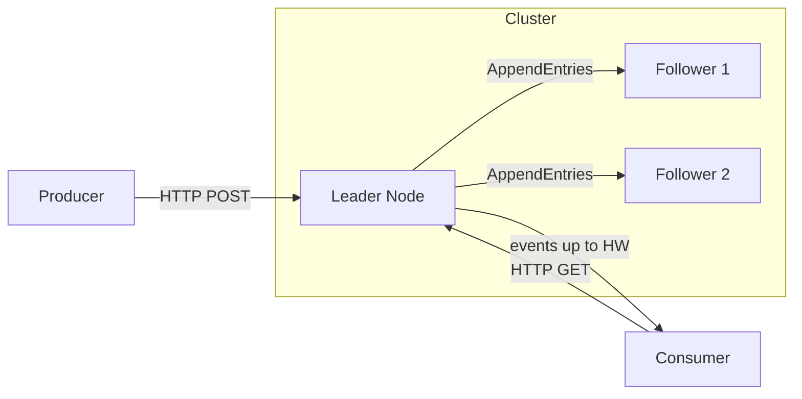
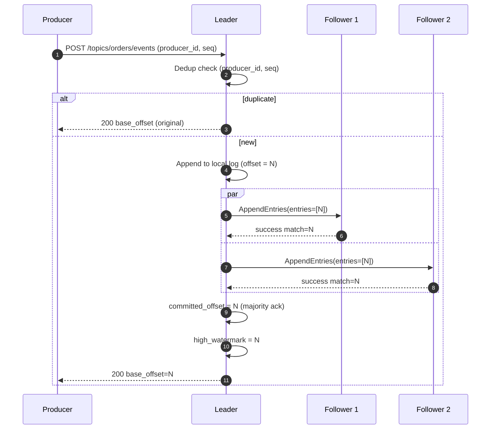
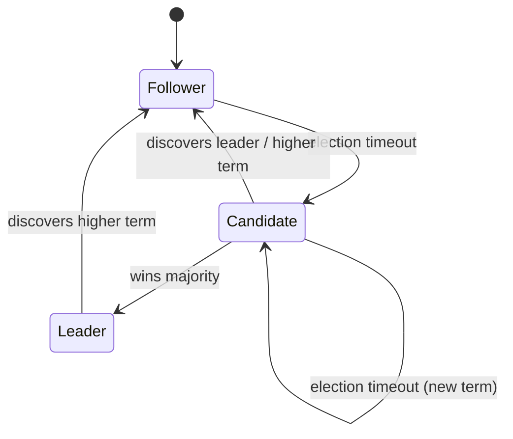

# 🦀 Rust Expert Journey

**A 12-month, 1,560-hour transition from Senior Java Engineer to Rust-focused Distributed Systems Engineer.**

[](https://www.rust-lang.org/)
[](#3-programme-at-a-glance)
[](#7-study-method)
[](#2-learning-allocation-7030)

## Table of contents

1. [Mission](#1-mission)
2. [Learning allocation: 70/30](#2-learning-allocation-7030)
3. [Programme at a glance](#3-programme-at-a-glance)
4. [Java → Rust transition pitfalls](#4-java--rust-transition-pitfalls-)
5. [Roadmap details (milestone-driven)](#5-roadmap-details-milestone-driven)
6. [Project architecture: Distributed Event Processing Platform](#6-project-architecture-distributed-event-processing-platform)
7. [Study method](#7-study-method)
8. [Core resources (mapped to topics)](#8-core-resources-mapped-to-topics)
9. [Engineering standards](#9-engineering-standards)
10. [Assessment and readiness gates](#10-assessment-and-readiness-gates)
11. [Repository structure](#11-repository-structure)
12. [Progress tracker](#12-progress-tracker)

---

## 1. Mission

This repository documents a practical, hands-on journey to become a Rust engineer specializing in **distributed systems and high-performance backend engineering**, supported by a solid foundation in systems programming.

The starting point is an experienced Senior Java Engineer / Software Architect. The goal is to transfer existing software architecture and distributed-systems experience into Rust while developing demonstrable Rust engineering skills.

### Target professional positioning

> **Senior Software Engineer | Rust | Distributed Systems | High-Performance Backend | Systems Programming**

Completing this roadmap does not automatically establish professional Rust experience or guarantee a Senior title. Readiness must be demonstrated through code, tests, design decisions, benchmarks, and the ability to explain technical trade-offs.

## 2. Learning allocation: 70/30

| Track | Allocation | Annual hours | Main outcome |
|---|---:|---:|---|
| Distributed Systems & High-Performance Backend | 70% | 1,092 h | Design, implement, test, and operate the platform |
| Systems Programming & Low-Level Rust | 30% | 468 h | Understand memory, concurrency, networking, Linux, and performance |
| **Total** | **100%** | **1,560 h** | **12-month programme** |

The 70/30 split describes the overall effort. Rust fundamentals are integrated into both tracks.

## 3. Programme at a glance

- **Duration:** 52 weeks (12 months).
- **Weekly commitment:** 30 hours.
- **Daily commitment:** 6 hours, Monday to Friday.
- **Total planned effort:** 1,560 hours.
- **Primary language:** Rust.
- **Primary specialization:** Distributed Systems & Backend.
- **Supporting specialization:** Systems Programming & Low-Level Rust.
- **Project strategy:** one platform, one repository, progressive milestones.

| Phase | Weeks | Hours | Milestones | Main focus |
|---|---:|---:|---:|---|
| 1. Rust Core & Ownership | 1–8 | 240 | 4 | Rust fundamentals and in-memory event engine |
| 2. Advanced Rust & Storage | 9–16 | 240 | 4 | Memory, concurrency, persistent storage and recovery |
| 3. Async Rust & Networking | 17–24 | 240 | 4 | Tokio, network API and concurrent clients |
| 4. Distributed Systems | 25–36 | 360 | 5 | Replication, coordination and failure handling |
| 5. Performance & Systems Programming | 37–44 | 240 | 4 | Profiling, memory, Linux I/O and optimization |
| 6. Production Readiness | 45–52 | 240 | 4 | Observability, deployment, testing and final release |
| **Total** | **1–52** | **1,560** | **25** | **One evolving platform** |

---

## 4. Java → Rust transition pitfalls ⚠️

> **Nota:** Vienes de Java Senior. Los errores más frecuentes al pasar a Rust no son de sintaxis sino de **modelo mental**. Aquí están las 15 trampas que te encontrarás, con el instinto Java vs. la respuesta Rust idiomática.

You will write Java-flavoured Rust for the first 2–3 months. This is normal and expected. The list below names the traps so you can recognize them faster.

### 4.1 Mutability is opt-in, not opt-out

**Java instinct:** variables are mutable by default; you opt out with `final`.
**Rust reality:** variables are immutable by default; you opt in with `mut`.

```rust
// Java-flavoured (wrong instinct)
let mut counter = 0;   // mut "just in case"
counter = compute();   // reassign

// Idiomatic Rust
let counter = compute(); // immutable, clear intent
```

**Trap:** sprinkling `mut` everywhere disables the compiler's aliasing analysis and makes refactoring harder. Add `mut` only when you actually rebind or mutate.

### 4.2 No inheritance, no classes — stop translating OOP hierarchies

**Java instinct:** model the domain with class hierarchies (`abstract class Event { ... }` subclassed by `OrderEvent`, `UserEvent`).
**Rust reality:** composition + traits. `enum` for closed variants, `trait` for shared behaviour, `struct` for data.

```rust
// Wrong: trying to build a class hierarchy
// struct OrderEvent extends Event { ... }   // <- does not compile

// Right: enum for closed variants
enum Event {
    Order { order_id: OrderId, amount: u64 },
    User  { user_id: UserId, action: UserAction },
}

// Right: trait for shared behaviour
trait Timestamped {
    fn timestamp(&self) -> Timestamp;
}
```

### 4.3 No `null` — `Option<T>` is the only nullable type

**Java instinct:** return `null` to mean "not found", then NPE at runtime.
**Rust reality:** `Option<T>` is enforced by the type system. You cannot forget to handle the `None` case.

```rust
fn find(&self, id: &str) -> Option<&Event> { self.map.get(id) }
match self.find("x") {
    Some(e) => println!("{}", e.timestamp()),
    None    => println!("not found"),
}
```

### 4.4 No exceptions — `Result<T, E>` and the `?` operator

**Java instinct:** throw checked/unchecked exceptions; catch upstream.
**Rust reality:** errors are values. `Result<T, E>` is the return type. `?` propagates. Panics are for **bugs**, not control flow.

```rust
fn read_event(path: &Path) -> Result<Event, ReadError> {
    let bytes = std::fs::read(path).map_err(ReadError::Io)?;
    let event = serde_json::from_slice(&bytes).map_err(ReadError::Decode)?;
    Ok(event)
}
```

**Trap:** `unwrap()` / `expect()` in library code panics on `None`/`Err`. Reserve them for tests or for invariants that, if violated, mean a bug.

### 4.5 Ownership changes API design, not just implementation

**Java instinct:** pass references freely; the GC cleans up.
**Rust reality:** every value has one owner. API signatures must declare who borrows, who owns, and for how long.

```rust
fn consume_owned(events: Vec<Event>)         { /* takes ownership */ }
fn consume_borrowed(events: &[Event])        { /* borrows read-only */ }
fn consume_mut(events: &mut Vec<Event>)      { /* borrows mutably */ }
```

**Rule of thumb:** borrow (`&T` / `&mut T`) by default; take ownership (`T`) only when you need to store, move, or consume the value.

### 4.6 Shared mutable state: borrow checker enforces "aliasing XOR mutability"

**Java instinct:** `synchronized`, `volatile`, `AtomicReference`, `ConcurrentHashMap` — the JVM lets you alias and mutate freely if you synchronize access.
**Rust reality:** you can have **multiple readers XOR one writer**, enforced at compile time. Shared mutability requires explicit interior mutability (`Mutex`, `RwLock`, `Cell`, `RefCell`, `Atomic*`).

```rust
use std::sync::{Arc, Mutex};

let counter = Arc::new(Mutex::new(0u64));
let handles: Vec<_> = (0..4).map(|_| {
    let c = Arc::clone(&counter);
    std::thread::spawn(move || {
        for _ in 0..1000 { *c.lock().unwrap() += 1; }
    })
}).collect();
for h in handles { h.join().unwrap(); }
assert_eq!(*counter.lock().unwrap(), 4000);
```

### 4.7 Iterators are zero-cost and lazy — use them heavily

**Java instinct:** `Stream` creates intermediate objects; performance-conscious code uses manual `for` loops.
**Rust reality:** iterators compile down to the same machine code as hand-written loops. Prefer iterator chains.

```rust
let total: u64 = events.iter()
    .filter(|e| e.is_valid())
    .map(|e| e.amount())
    .sum();
```

### 4.8 Two string types: `String` vs `&str`

**Java instinct:** one `String` type (plus `StringBuilder`).
**Rust reality:** `String` is heap-allocated, owned, growable; `&str` is a borrowed slice (may point into a `String`, into the binary's read-only segment, or into memory-mapped files).

**Rule of thumb:** functions take `&str` (or `impl AsRef<str>`); structs store `String` (or `Arc<str>` if shared and read-only).

### 4.9 Async is cooperative — never block inside `async`

**Java instinct:** blocking I/O in `CompletableFuture` is wasteful but works; virtual threads (Loom) make blocking cheap again.
**Rust reality:** async tasks run on a fixed-size thread pool. A blocking call (`std::thread::sleep`, `std::fs::read`, `std::net::TcpStream::read`) occupies the worker thread and starves other tasks. Use `tokio::time::sleep`, `tokio::fs`, `tokio::net`, or `spawn_blocking` for CPU-bound or unavoidably blocking work.

### 4.10 Generics: monomorphization, not type erasure

**Java instinct:** `List<T>` erases to `List<Object>`; you cannot do `T.class` or `new T()`.
**Rust reality:** generic functions are compiled once per concrete type (monomorphization), with zero runtime cost. You get specialization through trait bounds, not reflection.

```rust
fn sum<T: Add<Output = T> + Default + Copy>(xs: &[T]) -> T {
    xs.iter().copied().fold(T::default(), |a, b| a + b)
}
```

### 4.11 Equality, hashing and ordering are traits, not methods

| Concept | Java | Rust |
|---|---|---|
| Equality | `equals()` / `hashCode()` | `PartialEq` / `Eq` + `Hash` |
| Ordering | `Comparable<T>` | `Ord` / `PartialOrd` |
| Display | `toString()` | `Display` / `Debug` |
| Default ctor | no-arg constructor | `Default` trait |

Derive these traits with `#[derive(Debug, Clone, PartialEq, Eq, Hash)]` for plain data types.

### 4.12 Builder pattern: consume `self`, don't mutate

**Java instinct:** builder holds mutable state, returns `this` for chaining.
**Rust reality:** idiomatic builders take and return `Self` by value (move semantics), ending in a `build()` that consumes the builder. This makes half-built states unrepresentable when combined with `Option` fields.

### 4.13 Don't reach for `unsafe` to silence the borrow checker

**Java instinct:** "the compiler is in my way, I'll work around it."
**Rust reality:** `unsafe` does **not** disable the borrow checker — it only lifts specific restrictions (raw pointer dereference, mutable statics, calling unsafe FFI, accessing union fields). If the borrow checker complains, 99% of the time your design has an aliasing problem that `unsafe` will not fix; it will just turn a compile error into a data race at runtime.

### 4.14 Dependency injection without frameworks

**Java instinct:** Spring / Guice / CDI containers, `@Autowired`, bean graphs.
**Rust reality:** no DI framework. Pass dependencies as trait objects (`Arc<dyn Repo>`) or generics (`R: Repo`) through constructors. Configuration is explicit and type-checked.

### 4.15 Quick reference: Java → Rust concept map

| Java concept | Rust equivalent | Notes |
|---|---|---|
| `class` with fields | `struct` + `impl` block | Data and behaviour are separate |
| `interface` | `trait` | Traits can have default methods |
| `extends` / inheritance | composition + traits | No implementation inheritance |
| `null` | `Option<T>` | Type-enforced |
| checked exception | `Result<T, E>` | Value, not control flow |
| `synchronized` | `Mutex` / `RwLock` | Explicit lock type |
| `volatile` | `Atomic*` / `Ordering` | Memory ordering is explicit |
| `ArrayList<T>` | `Vec<T>` | |
| `HashMap<K,V>` | `HashMap<K,V>` / `BTreeMap<K,V>` | BTreeMap is ordered |
| `String` | `String` (owned) / `&str` (borrowed) | Two types |
| `Stream<T>` | `Iterator<Item = T>` | Zero-cost, lazy |
| `CompletableFuture` | `Future` + `async`/`await` | Cooperative, runtime-based |
| `Thread` | `std::thread::spawn` / Tokio task | OS thread vs green task |
| `try-with-resources` | `Drop` trait | RAII, deterministic |
| `equals/hashCode` | `PartialEq` / `Eq` / `Hash` | Derived or manual |
| `@Override toString()` | `Display` / `Debug` | Two traits: user-facing vs debug |
| Generics `<T>` | Generics `<T>` with trait bounds | Monomorphized, no erasure |
| Reflection | traits + `Any` (rare) | Avoid; design without it |

---

## 5. Roadmap details (milestone-driven)

All six phases contribute to the same project: **Distributed Event Processing Platform**. Exercises are useful, but the main implementation remains in this project repository.

Each phase is broken into **3–5 milestones** (25 total). Each milestone has: objective, project increment, and **acceptance criteria** that must be met before advancing.

**Milestone legend:** `M<phase>.<n>` — e.g. `M1.2` is the second milestone of Phase 1.

### Phase 1 — Rust Core & Ownership

**Weeks 1–8 · 240 hours · 4 milestones**

**Goal:** become productive with idiomatic Rust and understand ownership rather than translating Java patterns mechanically.

**Topics:** Toolchain, Cargo, crates, modules and workspaces · Variables, structs, enums, pattern matching and collections · Ownership, moves, borrowing, references, stack and heap · Traits, generics, iterators and closures · `Option`, `Result` and custom errors · Unit and integration testing.

| Milestone | Weeks | Objective | Project increment | Key acceptance criteria |
|---|---|---|---|---|
| **M1.1** Toolchain, Cargo, modules | 1–2 | Set up a reproducible Rust environment and write idiomatic Rust without Java idioms | Workspace + `Event`, `EventId`, `Topic`, `PartitionId` types + module skeleton | `cargo build`/`clippy`/`fmt` clean; explain `String` vs `&str` |
| **M1.2** Ownership, borrowing, references | 3–4 | Internalize the ownership model | `InMemoryStore` with `append(&mut self, event)` and `read(&self, offset, n) -> &[Event]` | No unnecessary clones; explain every signature's ownership choice |
| **M1.3** Traits, generics, errors, iterators | 5–6 | Write reusable, type-safe Rust | `StoreError` enum with `thiserror`; iterator-based `read_range`; `Producer`/`Consumer` traits | No `unwrap()` in non-test code; explain `dyn Trait` vs generics |
| **M1.4** Tests, CLI, integration | 7–8 | Ship a working in-memory event engine | Unit + integration tests; `clap` CLI: `replicate publish --topic orders --payload '...'` | ≥ 30 tests green; live demo < 2 min; explain per-partition ordering |

**Definition of Done (Phase 1):** Explain ownership and borrowing decisions · Implement append/read without unnecessary cloning · Organize code into modules and use `Result` / `Option` deliberately · Provide meaningful unit and integration tests.

### Phase 2 — Advanced Rust & Storage

**Weeks 9–16 · 240 hours · 4 milestones**

**Goal:** understand advanced Rust abstractions, memory behaviour, safe concurrency, and persistent storage with recovery.

**Topics:** Lifetimes, advanced traits, generics and trait objects · `Box`, `Rc`, `Arc`, `Cow`, `Cell` and `RefCell` · `Mutex`, `RwLock`, `Send` and `Sync` · Atomics and memory ordering fundamentals · Memory layout, alignment and allocation · File I/O, buffering, serialization and checksums · `unsafe` Rust and safety invariants.

| Milestone | Weeks | Objective | Project increment | Key acceptance criteria |
|---|---|---|---|---|
| **M2.1** Lifetimes, advanced traits, smart pointers | 9–10 | Design APIs with non-trivial lifetimes | `trait Log { fn append(...); fn read(...) -> impl Iterator; }`; `Cow`/`Bytes` in read path | Explain `Rc`/`Arc`/`Box` trade-offs; design object-safe traits |
| **M2.2** Concurrency primitives and atomics | 11–12 | Write correct multi-threaded Rust | `ConcurrentStore` (`Arc<RwLock<...>>`); 4-producer/4-consumer benchmark; `AtomicU64` offset | Run 60 s under `loom` with no errors; justify each `Ordering` |
| **M2.3** Memory layout, unsafe, file I/O | 13–14 | Serialize data to disk safely | On-disk segment format (header + payload + CRC32); `SegmentWriter`/`Reader` with `fsync` | Draw byte-level layout; `// SAFETY:` on every `unsafe`; corrupt tail detected |
| **M2.4** Persistent log and recovery | 15–16 | Ship a durable log that recovers after a crash | `PersistentStore`; segment rotation; sparse offset index; startup recovery | Crash test recovers committed events; recovery time for 1M events measured |

**Definition of Done (Phase 2):** Explain ownership and synchronization choices · Explain the storage format and recovery procedure · Demonstrate restart recovery with automated tests · Justify any `unsafe` block; avoid it when a safe solution exists.

### Phase 3 — Async Rust & Networking

**Weeks 17–24 · 240 hours · 4 milestones**

**Goal:** build reliable asynchronous network services with the Rust ecosystem.

**Topics:** Futures, `async` / `await` and Tokio runtime · Tasks, channels, synchronization and shared state · Cancellation, timeouts and graceful shutdown · TCP fundamentals and network framing · HTTP APIs with Axum; gRPC with Tonic when justified · Backpressure, bounded queues and load testing.

| Milestone | Weeks | Objective | Project increment | Key acceptance criteria |
|---|---|---|---|---|
| **M3.1** Futures, async/await, Tokio | 17–18 | Understand async Rust under the hood | Convert storage I/O to `tokio::fs` or wrap with `spawn_blocking` (ADR) | Draw state machine of an `async fn`; explain `Send + 'static` for `spawn` |
| **M3.2** Tasks, channels, shutdown | 19–20 | Build correct cooperative async systems | Pipeline: producer → bounded channel → storage → bounded channel → consumers; SIGTERM drain | `select!` timeout cancels correctly; bounded channels provide backpressure (tested) |
| **M3.3** TCP, framing, HTTP with Axum | 21–22 | Expose the store over a real network protocol | `POST /topics/{t}/events`, `GET /topics/{t}/events`; `/health`, `/ready`; `tower::timeout`/`limit` | curl smoke test passes; 504 on timeout; 1000 concurrent connections |
| **M3.4** Clients, backpressure, load testing | 23–24 | Prove the server handles real concurrent load | `replicate-client` crate with pooling/retries; load harness in `benches/load/` | P50/P95/P99 recorded; RSS bounded under load; backpressure location explained |

**Definition of Done (Phase 3):** Explain Tokio tasks, scheduling and cancellation · Demonstrate bounded resource usage under load · Run concurrent producer/consumer tests · Report throughput and latency percentiles.

### Phase 4 — Distributed Systems Engineering

**Weeks 25–36 · 360 hours · 5 milestones**

**Goal:** implement and test distributed behaviour, not merely deploy several independent services.

**Topics:** Failure models, network partitions, timeouts and retries · Ordering, idempotency, duplicate handling and delivery semantics · Leader/follower replication and consistency trade-offs · Heartbeats, failure detection and cluster membership · Raft concepts: elections, log replication and safety · Recovery, fault injection and resilience.

| Milestone | Weeks | Objective | Project increment | Key acceptance criteria |
|---|---|---|---|---|
| **M4.1** Failure models, ordering, idempotency | 25–27 | Establish distributed-systems scaffolding | `NodeId`, `ClusterConfig`; idempotent producer (ID + seqnum); offset commit endpoint; `docs/architecture/semantics.md` | Duplicate `(producer_id, seqnum)` returns original offset; ADR-004 written |
| **M4.2** Leader/follower, heartbeats | 28–30 | Implement single-leader replication with failure detection | 3-node cluster; per-partition leader (majority vote); heartbeats; follower catch-up | Leader elected within 5 s; re-election within 10 s; explain split-brain risk |
| **M4.3** Raft concepts | 31–33 | Study and partially implement Raft | Decide scope in ADR-005 (full Raft or simplified); `RequestVote`/`AppendEntries` or simplified equivalent | Survive single-node failure with no data loss; partition isolating leader blocks commits |
| **M4.4** Recovery, fault injection | 34–35 | Prove the system recovers from realistic failures | `toxiproxy` tests (latency, loss, drops); chaos suite; `docs/operations/recovery.md` | ≥ 10 fault-injection tests green; runbook covers leader death, partition, full restart |
| **M4.5** Consistency documentation | 36 | Produce a precise, defensible statement of guarantees | `docs/architecture/consistency.md`; `docs/architecture/failure-model.md`; README "Guarantees" section | No overclaims; every guarantee backed by a test; defend in mock interview |

**Definition of Done (Phase 4):** Run a small multi-node cluster · Demonstrate replication and recovery · Test selected node and network failures · Explain precisely what the platform guarantees and what it does not.

**Scope control:** this is a focused learning platform, not a Kafka clone or production replacement. Do not claim exactly-once delivery, linearizability or production-grade consensus unless the implementation and tests establish those guarantees. Studying Raft does not require implementing the full algorithm.

### Phase 5 — Performance & Systems Programming

**Weeks 37–44 · 240 hours · 4 milestones**

**Goal:** understand performance from application code down to memory, CPU and operating-system interactions.

**Topics:** Criterion benchmarks and statistical interpretation · CPU, allocation and memory profiling · Cache locality, data layout and alignment · Zero-copy parsing and buffer management · Lock contention and synchronization costs · Linux processes, threads, sockets and I/O · `epoll`, SIMD fundamentals and justified `unsafe`.

| Milestone | Weeks | Objective | Project increment | Key acceptance criteria |
|---|---|---|---|---|
| **M5.1** Benchmarks and profiling setup | 37–38 | Establish reproducible measurement infrastructure | `benches/` with criterion (append, read, rotation, recovery); `make profile` target; baselines in `docs/benchmarks/` | Reproducible ±5%; flamegraph committed; top 3 hot functions identified |
| **M5.2** CPU, memory, allocations | 39–40 | Reduce avoidable allocations and copies | `dhat` profile; `String`→`Bytes`/`&str`; `Vec<u8>`→`BytesMut`; `bumpalo` for handlers | Allocations per produce ≥ 50% reduction; P99 improved; before/after in commits |
| **M5.3** Cache, layout, contention | 41–42 | Improve cache utilization and reduce sync overhead | Shard `RwLock` by partition ID; reorder hot structs into cache lines | Lock-wait reduced; explain false sharing with example; throughput up vs M5.2 |
| **M5.4** Linux I/O, SIMD, unsafe audit | 43–44 | Push into systems-level optimizations where justified | `mmap` reads; SIMD CRC32 if hot; `// SAFETY:` audit; final perf report | Final report shows cumulative gains; every `unsafe` justified; all earlier tests pass |

**Definition of Done (Phase 5):** Identify bottlenecks using profiling evidence · Publish reproducible benchmark results · Explain the trade-offs behind each optimization · Demonstrate that optimizations preserve correctness.

### Phase 6 — Production Distributed Rust

**Weeks 45–52 · 240 hours · 4 milestones**

**Goal:** deliver a production-oriented release candidate and present it as a professional engineering portfolio project.

**Topics:** Structured logging, metrics and distributed tracing · OpenTelemetry and health checks · Configuration, secrets and security basics · Docker and Kubernetes deployment fundamentals · CI/CD and automated quality gates · Load, soak and fault-injection testing · Architecture Decision Records and operational runbooks.

| Milestone | Weeks | Objective | Project increment | Key acceptance criteria |
|---|---|---|---|---|
| **M6.1** Observability | 45–46 | Make the system observable in production | `tracing` + metrics (throughput, latency, lag); OTLP traces to Jaeger; `/health`, `/ready` | End-to-end trace in Jaeger; Grafana dashboard; explain logs vs metrics vs traces |
| **M6.2** Config, Docker, Kubernetes | 47–48 | Make the system deployable in standard container orchestration | Multi-stage Dockerfile < 50 MB; StatefulSet (3 replicas) + Service + ConfigMap; `docker-compose` for local dev | `docker build` < 50 MB; `kubectl apply` brings up 3-node cluster; pod failure recovered |
| **M6.3** CI/CD, soak testing | 49–50 | Automate quality and prove stability under sustained load | `.github/workflows/ci.yml` (fmt, clippy, test, doc, audit); `release.yml`; 1-hour soak test | CI green on main; soak shows stable RSS/throughput; `cargo audit` clean |
| **M6.4** Docs, ADRs, final release | 51–52 | Deliver a release candidate a reviewer can clone and run | README quickstart; ≥ 10 ADRs; `docs/operations/` runbooks; 20-min walkthrough; tag `v1.0.0-rc1` | Stranger runs cluster in < 15 min; ADRs follow template; guarantees defensible |

**Definition of Done (Phase 6):** A reviewer can clone and run the platform using the README · CI runs formatting, linting, tests and builds · Deployment and observability are demonstrated · Test and benchmark results are reproducible · Architecture, failure model and limitations are documented · A technical walkthrough is ready for interviews.

---

## 6. Project architecture: Distributed Event Processing Platform

One project evolves throughout the roadmap. It receives events, validates and stores them, distributes them across partitions, and allows consumers to process them. Later phases add persistence, networking, replication, recovery and observability.

The project takes inspiration from selected event-streaming concepts. **It is not a Kafka clone, Kafka-compatible broker or production Kafka replacement.**

### 6.1 Module map

```text
┌──────────────────────────────────────────────────────────────┐
│                       API layer (Axum)                        │
│  POST /topics/{t}/events   GET /topics/{t}/events   /health   │
└───────────────┬──────────────────────────────┬────────────────┘
                │                              │
        ┌───────▼────────┐           ┌─────────▼─────────┐
        │   producer/    │           │     consumer/     │
        │  (idempotent   │           │  (offset track,   │
        │   dedup, seq)  │           │   commit, poll)   │
        └───────┬────────┘           └─────────┬─────────┘
                │                              │
        ┌───────▼──────────────────────────────▼─────────┐
        │                    topic/                       │
        │       (topic registry, partition router)        │
        └───────┬──────────────────────────────────────────┘
                │
        ┌───────▼──────────────────────────────────────────┐
        │                  partition/                      │
        │    (partition state, leader/follower role)       │
        └───────┬──────────────────────────────────────────┘
                │
        ┌───────▼──────────────────────────────────────────┐
        │                    storage/                      │
        │   (append-only log, segment, index, recovery)    │
        └───────┬──────────────────────────────────────────┘
                │
        ┌───────▼──────────────────────────────────────────┐
        │                 replication/                     │
        │    (leader→follower AppendEntries, catch-up)     │
        └──────────────────────────────────────────────────┘
```

| Module | Introduced in | Responsibility |
|---|---|---|
| `event/` | M1.1 | `Event`, `EventId`, `Timestamp`, `Headers` types; serialization |
| `topic/` | M1.1 | Topic registry; partition count; partition-key routing |
| `partition/` | M1.2 | Partition state (log handle, leader/follower role, offset) |
| `storage/` | M1.4 → M2.4 | In-memory store (M1.4) → persistent append-only log (M2.4) |
| `consumer/` | M3.4 | Consumer groups, offset tracking, commit, poll |
| `network/` | M3.3 | HTTP API (Axum), TCP framing for replication |
| `replication/` | M4.2 | Leader→follower AppendEntries, heartbeats, catch-up |
| `observability/` | M6.1 | `tracing`, metrics, OpenTelemetry, health endpoints |

### 6.2 Core data structures

#### Event record (in-memory and on-the-wire)

```rust
#[derive(Debug, Clone, PartialEq, Eq, Hash)]
pub struct Event {
    pub id: EventId,            // client-provided or generated UUIDv7
    pub topic: TopicName,       // validated, normalized string
    pub partition: PartitionId, // u32, assigned by router
    pub timestamp: Timestamp,   // producer or broker wall-clock (ms)
    pub headers: Headers,       // small Vec<(String, Bytes)>
    pub key: Option<Bytes>,     // partitioning key
    pub payload: Bytes,         // opaque payload
}

pub type EventId = [u8; 16];         // UUIDv7 (time-ordered)
pub type PartitionId = u32;
pub type Offset = u64;
pub type Timestamp = u64;            // ms since epoch
pub type Headers = SmallVec<[(SmolStr, Bytes); 4]>;
```

**Design notes:**
- `Bytes` (from the `bytes` crate) is reference-counted and cheap to clone; avoids `Vec<u8>` copies.
- `SmallVec` for headers: most events have 0–4 headers; heap allocation only above the inline capacity.
- `EventId` as `[u8; 16]` (not `uuid::Uuid`) keeps the type `Copy` and avoids a dependency in the core module.

#### On-disk segment format

Each partition is stored as a sequence of **segment files**. A segment rolls over when it reaches a configurable size (default 1 GiB). Files are named `<partition_id>-<base_offset>.log` and `<partition_id>-<base_offset>.idx`.

**Record layout** (within a `.log` file):

```text
┌──────────────────────────────────────────────────────────────┐
│ Record Header (24 bytes, fixed)                              │
├────────────┬────────────┬────────────┬───────────────────────┤
│ crc32 (4B) │ length (4B)│ offset (8B)│ timestamp (8B)        │
├────────────┴────────────┴────────────┴───────────────────────┤
│ Payload (variable, `length` bytes)                           │
│   ┌────────────┬─────────────────────────────────────────┐   │
│   │ key_len(4B)│ key (key_len bytes, may be 0)           │   │
│   ├────────────┼─────────────────────────────────────────┤   │
│   │ hdr_count  │ headers (repeated: name_len, name,      │   │
│   │ (2B)       │ value_len, value)                       │   │
│   ├────────────┼─────────────────────────────────────────┤   │
│   │ value_len  │ value (value_len bytes)                 │   │
│   │ (4B)       │                                         │   │
│   └────────────┴─────────────────────────────────────────┘   │
└──────────────────────────────────────────────────────────────┘
```

- `crc32` covers `length` + `offset` + `timestamp` + payload. Validated on every read; a mismatch truncates the segment at the previous valid record.
- `offset` is stored per-record (not implied by position) to support sparse index and verification.
- Big-endian byte order for portability across architectures.

**Sparse offset index** (`.idx` file): one entry per 4 KiB of log data (configurable). Binary search to find the entry ≤ target offset; then linear scan within the segment. Rebuilt on recovery if missing or stale.

#### Offset and consumer state

```rust
pub struct PartitionState {
    pub partition: PartitionId,
    pub log: LogHandle,            // Arc<RwLock<SegmentLog>>
    pub role: ReplicaRole,         // Leader { term, lease_until } | Follower { leader_id, term }
    pub committed_offset: Offset,  // highest offset acked by a majority
    pub high_watermark: Offset,    // highest offset safe to expose to consumers
}

pub struct ConsumerGroup {
    pub group: GroupName,
    pub assignments: HashMap<PartitionId, ConsumerId>,
    pub offsets: HashMap<PartitionId, Offset>,  // last committed offset per partition
}
```

- `committed_offset` ≤ `high_watermark` ≤ log end.
- Consumers read up to `high_watermark`; reading uncommitted data is off by default.

### 6.3 APIs

#### Client HTTP API (Axum)

| Method | Path | Purpose | Idempotent? |
|---|---|---|---|
| `POST` | `/topics/{topic}/events` | Publish one or more events | Yes, with `(producer_id, seqnum)` |
| `GET` | `/topics/{topic}/events?offset=N&max=M` | Poll events from a partition | Yes (read-only) |
| `POST` | `/topics/{topic}/partitions/{p}/offsets` | Commit a consumer offset | Yes (last-write-wins) |
| `GET` | `/topics/{topic}/partitions/{p}/offsets` | Fetch last committed offset | Yes |
| `GET` | `/topics` | List topics | Yes |
| `POST` | `/topics` | Create a topic with N partitions | Yes (idempotent create) |
| `GET` | `/health` | Liveness: process up | Yes |
| `GET` | `/ready` | Readiness: can serve requests | Yes |
| `GET` | `/metrics` | Prometheus scrape | Yes |

**Publish request body:**

```json
{
  "producer_id": "prod-abc-123",
  "sequence_number": 42,
  "events": [
    {
      "key": "order-1001",
      "headers": {"content-type": "application/json"},
      "payload": "<base64>"
    }
  ]
}
```

**Publish response:**

```json
{
  "partition": 3,
  "base_offset": 1048576,
  "offsets": [1048576]
}
```

Duplicate `(producer_id, sequence_number)` returns the original `base_offset` without appending.

#### Internal replication protocol (subset of Raft's RPC set)

```text
AppendEntries       (leader → follower)
  term: u64
  leader_id: NodeId
  prev_log_offset: Offset
  prev_log_term: u64
  entries: Vec<LogEntry>     // may be empty (heartbeat)
  leader_commit: Offset

AppendEntriesResponse (follower → leader)
  term: u64
  success: bool
  match_index: Offset        // highest contiguous offset the follower has

RequestVote         (candidate → peer)        [only if full Raft is implemented]
  term: u64
  candidate_id: NodeId
  last_log_offset: Offset
  last_log_term: u64
```

### 6.4 Architecture diagrams (Mermaid)

#### High-level system context



#### Write path (produce request)



#### Leader election (simplified)



### 6.5 Design decisions and trade-offs (ADR index)

ADRs live in `docs/adr/`. The list below is the expected set by end of Phase 6; not all exist from day one.

| ADR | Title | Summary |
|---|---|---|
| ADR-001 | Use Cargo workspace, single binary | One crate per module; one binary; feature flags for in-memory vs. persistent storage. |
| ADR-002 | `Bytes` over `Vec<u8>` in the hot path | Reference-counted, cheap clone; worth the dependency. |
| ADR-003 | HTTP/JSON for clients, binary over TCP for replication | Client ergonomics vs. replication throughput. |
| ADR-004 | At-least-once delivery, no exactly-once | Exactly-once needs transactional consumers; out of scope. Idempotent producer + at-least-once consumer. |
| ADR-005 | Simplified leader election, not full Raft | Time-boxed; full Raft is a stretch goal. Document the safety properties lost. |
| ADR-006 | `fsync` per batch, not per write | Throughput vs. durability trade-off; configurable. |
| ADR-007 | Sparse index, 4 KiB granularity | Index size vs. read latency; rebuildable on corruption. |
| ADR-008 | `tracing` over `log` | Structured, async-aware, OTLP-compatible. |
| ADR-009 | StatefulSet for Kubernetes deployment | Stable network identity and persistent volumes per pod. |
| ADR-010 | `tokio` multi-threaded runtime | Workloads are I/O + CPU mixed; blocking pool for `spawn_blocking`. |

### 6.6 Final project expectations

- Documented event and API contracts.
- Persistence and restart recovery.
- Partition ordering and consumer offset tracking.
- A clearly scoped replication model.
- Bounded queues and backpressure.
- Graceful shutdown and tested failure handling.
- Metrics, logs and traces.
- Repeatable load and fault-injection tests.
- Explicit guarantees and known limitations.

### 6.7 Phase → project increment summary

| Phase | Project increment |
|---|---|
| 1 | In-memory event model, topics, partitions, append and read |
| 2 | Persistent append-only log, index and restart recovery |
| 3 | Async network API, concurrent producers/consumers and backpressure |
| 4 | Small multi-node cluster, replication and failure handling |
| 5 | Profiling and measured performance improvements |
| 6 | Observability, deployment, automated tests and release candidate |

---

## 7. Study method

A standard 30-hour week is divided as follows:

| Activity | Hours/week |
|---|---:|
| Books and official documentation | 5 |
| Focused exercises and code reading | 5 |
| Project implementation | 12.5 |
| Testing, debugging and profiling | 5 |
| Review and technical documentation | 2.5 |
| **Total** | **30** |

Suggested daily allocation (Monday–Friday):

| Activity | Hours/day |
|---|---:|
| Reading and documentation | 1 |
| Exercises and code reading | 1 |
| Project implementation | 2.5 |
| Testing, debugging and profiling | 1 |
| Review and learning log | 0.5 |
| **Total** | **6** |

Use this as a planning baseline, not a rigid rule. Some weeks will need more implementation or debugging time.

### Weekly review

At the end of each week, record:

1. What was learned and implemented?
2. Which code was written without following a tutorial?
3. Which tests demonstrate the expected behaviour?
4. What technical problem took the most time?
5. Which design decision can be explained and defended?
6. What remains incomplete?
7. What is next week's measurable objective?

---

## 8. Core resources (mapped to topics)

Prefer official documentation and primary learning material. Use books at the relevant phase; they do not all need to be read sequentially.

### 8.1 Rust language and engineering

| Resource | When | Used for |
|---|---|---|
| [The Rust Programming Language](https://doc.rust-lang.org/book/) (TRPL) | Phase 1–2 | First read; ch. 4, 10, 15, 16 are the most valuable |
| [Rust By Example](https://doc.rust-lang.org/rust-by-example/) | Phase 1 | Quick syntax reference |
| [Rustlings](https://github.com/rust-lang/rustlings) | Phase 1 | Muscle memory for syntax |
| [The Rust Standard Library](https://doc.rust-lang.org/std/) | All phases | API reference |
| [The Cargo Book](https://doc.rust-lang.org/cargo/) | Phase 1 | Workspaces, manifests, features |
| [The Rustonomicon](https://doc.rust-lang.org/nomicon/) | Phase 2, 5 | `unsafe`, lifetimes, dark corners |
| [The Rust Reference](https://doc.rust-lang.org/reference/) | Phase 2, 5 | Type layout, ABI, semantics |
| [Rust for Rustaceans](https://rust-for-rustaceans.com/) (Jon Gjengset) | Phase 2–5 | Deeper API design, async, unsafe, performance |
| *Programming Rust* (Blandy, Orendorff, Tindall) | Phase 1–2 | Rigorous ownership, traits, concurrency chapters |
| *Effective Rust* (Drysdale) | Phase 2–3 | Idioms; 35 short items |
| *Rust Atomics and Locks* (Mara Bos) | Phase 2 (selectively), Phase 5 | Atomics and memory ordering |
| [Rust API Guidelines](https://rust-lang.github.io/api-guidelines/) | Phase 2–3 | Naming, interop, discoverability |

### 8.2 Async Rust and networking

| Resource | When | Used for |
|---|---|---|
| [Asynchronous Programming in Rust](https://rust-lang.github.io/async-book/) | Phase 3 | `Future`, `Pin`, `Poll`, executors |
| [Tokio Tutorial](https://tokio.rs/tokio/tutorial) | Phase 3 | Hands-on runtime intro |
| [Tokio documentation](https://docs.rs/tokio/) | Phase 3, 5 | API reference; `tokio::select`, `tokio::sync` |
| [Axum documentation](https://docs.rs/axum/) | Phase 3 | HTTP API |
| [Tonic documentation](https://docs.rs/tonic/) | Phase 3 (if gRPC) | gRPC |
| [Tower documentation](https://docs.rs/tower/) | Phase 3, 6 | Middleware, retries, limits |
| Jon Gjengset, "Crust of Rust" YouTube series | Phase 2–5 | Iterators, lifetimes, channels, atomics — deep videos |

### 8.3 Distributed systems

| Resource | When | Used for |
|---|---|---|
| [MIT 6.824 Distributed Systems](https://pdos.csail.mit.edu/6.824/) | Phase 4 | Lectures; Labs as reference |
| [Raft paper](https://raft.github.io/raft.pdf) | Phase 4 (M4.3) | Read twice |
| [Raft visualization](https://raft.github.io/) | Phase 4 | Intuition |
| *Designing Data-Intensive Applications* (Kleppmann) | Phase 4 (and reference) | ch. 5, 8, 9 are essential |
| *Database Internals* (Petrov) | Phase 2, 4 | Storage (Part I), consensus (Part II) |
| [The Raft Thesis](https://web.stanford.edu/~ouster/cgi-bin/papers/OngaroPhD.pdf) (Ongaro) | Phase 4 (if full Raft) | Reference for edge cases |
| [Aphyr's Jepsen analyses](https://aphyr.com/) | Phase 4 (M4.5) | How real systems break their claims |

### 8.4 Performance and systems

| Resource | When | Used for |
|---|---|---|
| *Systems Performance* (Brendan Gregg) | Phase 5, 6 | Profiling methodology, Linux observability |
| [Criterion.rs](https://github.com/criterion-rs/criterion.rs) | Phase 5 | Microbenchmarks |
| [Flamegraph](https://github.com/flamegraph-rs/flamegraph) | Phase 5 | CPU profiling |
| [Rust Performance Book](https://nnethercote.github.io/perf-book/) | Phase 5 | Idioms for performance |
| [Linux man-pages](https://man7.org/linux/man-pages/) | Phase 5 | `epoll`, `mmap`, `sendfile`, `io_uring` |
| [Performance Analysis Tools](https://brendangregg.com/perf.html) (Brendan Gregg) | Phase 5 | `perf`, flamegraphs, eBPF |

### 8.5 Production and operations

| Resource | When | Used for |
|---|---|---|
| [Google SRE Book](https://sre.google/sre-book/table-of-contents/) | Phase 6 | Monitoring, incidents, runbooks |
| [12-Factor App](https://12factor.net/) | Phase 6 | Configuration, logs, processes |
| [OpenTelemetry Rust](https://github.com/open-telemetry/opentelemetry-rust) | Phase 6 | Tracing |
| [Prometheus documentation](https://prometheus.io/docs/) | Phase 6 | Metrics |
| [C4 model](https://c4model.com/) | Phase 6 | Architecture diagrams |
| [ADRs](https://adr.github.io/) | Phase 2+ | Decision records |

### 8.6 Communities and newsletters

- [r/rust](https://www.reddit.com/r/rust/) — news and discussion.
- [This Week in Rust](https://this-week-in-rust.org/) — weekly digest.
- [users.rust-lang.org](https://users.rust-lang.org/) — official forum.
- [Rust Zulip](https://rust-lang.zulipchat.com/) — deep technical chat; working groups.
- Jon Gjengset's [stream archive](https://www.youtube.com/@jonhoo) — long-form Rust code reading.

---

## 9. Engineering standards

Apply these standards throughout the repository:

- Format code with `cargo fmt`.
- Run `cargo clippy` and address relevant warnings.
- Use `cargo test` for automated tests.
- Add integration tests for externally observable behaviour.
- Use property-based tests where they add meaningful coverage.
- Use benchmarks for performance claims.
- Avoid unexplained `unwrap()` and `expect()` in production paths.
- Keep `unsafe` minimal and document its safety invariants.
- Document concurrency assumptions and failure behaviour.
- Record significant design decisions as ADRs.
- Never publish secrets or sensitive test data.

Useful baseline commands:

```bash
rustup update
rustc --version
cargo --version

cargo fmt --all -- --check
cargo clippy --workspace --all-targets --all-features -- -D warnings
cargo test --workspace
```

Use workspace-wide commands once the repository is configured as a Cargo workspace.

---

## 10. Assessment and readiness gates

Progress is measured by evidence, not by hours completed.

| Gate | Expected evidence |
|---|---|
| End of Phase 1 | Idiomatic Rust fundamentals, ownership explanations and tested in-memory event engine |
| End of Phase 2 | Persistent storage, recovery tests and sound memory/concurrency decisions |
| End of Phase 3 | Async API, concurrent clients, cancellation and load-test evidence |
| End of Phase 4 | Multi-node platform, replication tests and documented failure semantics |
| End of Phase 5 | Reproducible benchmarks, profiling evidence and measured optimizations |
| End of Phase 6 | Deployable release candidate, observability, automated tests and technical walkthrough |

### Final senior-level assessment

Before applying for Rust-focused senior roles, verify that you can:

- Solve non-trivial Rust problems without step-by-step tutorials.
- Explain ownership, lifetimes, traits, `Send`, `Sync` and async execution.
- Diagnose concurrency and performance problems.
- Design network protocols and service interfaces.
- Explain consistency, replication and partial failures.
- Build and operate a multi-node Rust system.
- Review unfamiliar Rust code and identify risks.
- Defend technical decisions and explain trade-offs clearly.

The project is evidence of capability, not a substitute for commercial Rust employment history.

---

## 11. Repository structure

The repository contains one product. Add modules progressively; do not create empty directories for future phases on day one.

```text
rust-expert-journey/
├── README.md
├── Cargo.toml
├── Cargo.lock
├── rust-toolchain.toml
├── crates/
│   ├── core/                   # event, topic, partition types (no I/O)
│   ├── storage/                # in-memory + persistent log (M1.4, M2.4)
│   ├── network/                # HTTP API + TCP framing (M3.3)
│   ├── replication/            # leader/follower, AppendEntries (M4.2)
│   ├── observability/          # tracing, metrics, health (M6.1)
│   └── server/                 # binary: wires everything together
├── tests/
│   └── chaos/
├── benches/
│   └── load/
├── docs/
│   ├── architecture/
│   ├── adr/
│   ├── operations/
│   ├── benchmarks/
│   └── learning-log/
├── deploy/
│   ├── docker/
│   └── kubernetes/
└── .github/
    └── workflows/
```

---

## 12. Progress tracker

Update this table as evidence is completed.

### Phase-level tracker

| Phase | Status | Start date | End date | Evidence link |
|---|---|---|---|---|
| 1. Rust Core & Ownership | Not started | | | |
| 2. Advanced Rust & Storage | Not started | | | |
| 3. Async Rust & Networking | Not started | | | |
| 4. Distributed Systems | Not started | | | |
| 5. Performance & Systems Programming | Not started | | | |
| 6. Production Readiness | Not started | | | |

### Milestone-level tracker

| Phase | Milestone | Status | Notes / link |
|---|---|---|---|
| 1 | M1.1 Toolchain, Cargo, modules | Not started | |
| 1 | M1.2 Ownership, borrowing | Not started | |
| 1 | M1.3 Traits, generics, errors | Not started | |
| 1 | M1.4 Tests, CLI, integration | Not started | |
| 2 | M2.1 Lifetimes, advanced traits | Not started | |
| 2 | M2.2 Concurrency, atomics | Not started | |
| 2 | M2.3 Memory, unsafe, file I/O | Not started | |
| 2 | M2.4 Persistent log, recovery | Not started | |
| 3 | M3.1 Futures, async, Tokio | Not started | |
| 3 | M3.2 Tasks, channels, shutdown | Not started | |
| 3 | M3.3 TCP, framing, Axum | Not started | |
| 3 | M3.4 Clients, backpressure, load | Not started | |
| 4 | M4.1 Failure models, idempotency | Not started | |
| 4 | M4.2 Leader/follower, heartbeats | Not started | |
| 4 | M4.3 Raft concepts | Not started | |
| 4 | M4.4 Fault injection, recovery | Not started | |
| 4 | M4.5 Consistency documentation | Not started | |
| 5 | M5.1 Benchmarks, profiling setup | Not started | |
| 5 | M5.2 CPU, memory, allocations | Not started | |
| 5 | M5.3 Cache, layout, contention | Not started | |
| 5 | M5.4 Linux I/O, SIMD, unsafe audit | Not started | |
| 6 | M6.1 Observability | Not started | |
| 6 | M6.2 Config, Docker, K8s | Not started | |
| 6 | M6.3 CI/CD, soak testing | Not started | |
| 6 | M6.4 Docs, ADRs, final release | Not started | |

Suggested status values: `Not started`, `In progress`, `Completed`, `Needs review`.

---

## Guiding principle

**Build, measure, break, recover, and explain.**

The goal is not to collect Rust syntax or finish books. The goal is to demonstrate that you can design, implement, test, optimize and operate reliable distributed software in Rust.
````
